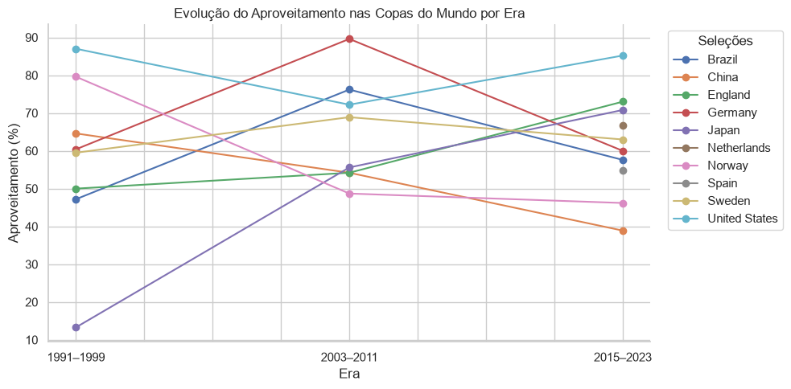

# Análise exploratória de dados: Futebol Feminino Internacional (1956-2026)

Análise exploratória de dados (EDA) sobre mais de 11.000 partidas de futebol internacional feminino, de 1956 a 2026. Projeto feito para praticar limpeza de dados, visualização e storytelling com dados usando **Pandas**, **Matplotlib** e **Seaborn**.

## Motivação

Em 2027, o Brasil vai sediar pela primeira vez uma Copa do Mundo Feminina, a primeira em solo sul-americano. Como meu conhecimento sobre o cenário internacional do esporte sempre foi limitado, usei o projeto para conhecer melhor a história das copas e o futebol feminino fora do Brasil antes da bola rolar em casa.

<p align="center">
  
</p>

## Perguntas e respostas

1. **Quais seleções dominam o cenário internacional?**
   Os Estados Unidos lideram a elite histórica de forma isolada, seguidos pela Alemanha; Brasil, Suécia, Noruega, Japão, China e Inglaterra formam um grupo intermediário (no máximo um título cada e saldo negativo no confronto direto contra as duas líderes), e a Espanha desponta como candidata a entrar.
2. **Fora do radar: quais seleções além das tradicionais chamam atenção?**
   México, Jordânia, El Salvador e Colômbia combinam forte crescimento e alto rendimento, mas quase todas jogaram contra adversários mais fracos; Colômbia e Filipinas, com um quarto a um terço dos jogos contra tradicionais, têm o calendário mais exigente entre as líderes.
3. **Como foi a evolução das principais seleções nas Copas do Mundo?**
   O topo é estável (EUA e Alemanha) e o meio muda: Japão e Inglaterra subiram, Noruega e China caíram, e Brasil, Alemanha e Suécia tiveram o pico em 2003–2011 e recuaram depois.
4. **Como o número de jogos e seleções participantes evoluiu ao longo do tempo?**
   Partidas por ano e seleções ativas cresceram a cada década (em parte por melhor cobertura do dataset, sobretudo de amistosos), com a entrada de seleções novas perdendo ritmo desde os anos 2000, e a Copa passou de 12 para 32 seleções.
5. **O nível de jogo mudou ao longo das edições da Copa do Mundo?**
   As Copas ficaram mais equilibradas até 2019 (menos goleadas) e, em 2023, com 32 seleções, as goleadas voltaram a subir, em boa parte contra estreantes, mas os dados não isolam o peso de cada fator.
6. **Jogar em casa é uma vantagem real?**
   Sim, de forma consistente: cada seleção rende mais em casa do que fora (cerca de 12 p.p. de aproveitamento nos jogos competitivos), mas, no recorte das seleções-sede em Copas, a amostra é pequena demais para confirmar o tamanho do efeito.

## Principais conclusões

1. **Topo estável, meio rotativo.** EUA e Alemanha formam o núcleo da elite histórica, e abaixo deles o meio muda de mãos ao longo das décadas.
2. **O torneio cresceu, e o nível do adversário distorce parte dos números.** O aproveitamento trata todos os adversários como iguais, então as seleções fora do radar, as goleadas e a vantagem de jogar em casa podem refletir adversários mais fracos.
3. **O Brasil é 3º no ranking histórico competitivo, mas 6º entre as 12 principais no confronto direto, e em queda nas Copas:** da semifinal (1999) e da final (2007) para as oitavas (2015 e 2019) e a fase de grupos em 2023. Para 2027, os dados sustentam expectativa moderada: o Brasil está no grupo intermediário da elite, com a vantagem geral de jogar em casa (de tamanho incerto em Copas), mas sem favoritismo claro.

## Estrutura do projeto

```
.
├── README.md
├── LINCENSE
├── .gitignore
├── requirements.txt
├── config.py                      # listas de classificação (torneios não competitivos e confederações)
├── _limpeza.ipynb                 # limpeza dos dados brutos
├── analise_futebol_feminino.ipynb # análise exploratória (as 6 perguntas)
├── imagens/
   │   └── aproveitamente_casa_fora
   │   └── evolucao_aproveitamento.png
   │   └── gols_goleadas.png
   │   └── mapa_calor_confronto_direto.png
   │   └── partidas_seleoes_por_ano.png
   │   └── sel_part_ano.png
   │   └── selecao_sede_visitantes.png
   │   └── selecoes_ativas_confederacao.png
   │   └── trajetoria_finalistas.png
└── data/
    ├── results.csv                # partidas (bruto)
    ├── shootouts.csv              # disputas de pênaltis (bruto)
    ├── goalscorers.csv            # artilheiros (bruto, não utilizado)
    ├── results_limpo.csv          # partidas (limpo, gerado por _limpeza.ipynb)
    └── shootouts_limpo.csv        # pênaltis (limpo, gerado por _limpeza.ipynb)
```

## Sobre os dados

Dataset público e colaborativo em andamento, mantido por [martj42](https://github.com/martj42) e publicado no Kaggle como [*Women's International Football Results*](https://www.kaggle.com/datasets/martj42/womens-international-football-results). 
Depois da limpeza são 11.650 partidas, 244 seleções e 118 torneios, de 1956 a junho de 2026, entre amistosos, qualificatórias, Copas do Mundo, Euros e outros torneios continentais.

O arquivo `goalscorers.csv` acompanha o dataset, mas não foi usado nesta análise.

## Limpeza de dados

O dataset já vinha estruturado (sem nulos nem duplicatas), mas exigiu correções, todas documentadas em `_limpeza.ipynb`:

| Etapa | Decisão |
|---|---|
| Nomes de seleções | 4 pares unificados: 248 → 244 seleções |
| Nomes de torneios | 3 erros de grafia corrigidos e `World Cup` renomeado para `World Cup (pre-FIFA)`: 121 → 118 torneios |
| Placares | Corrigidos Camarões x África do Sul (2006), de 2x24 para 2x2, e Polônia x Rússia (2011), de 0-20 para 0-2; outros placares extremos foram conferidos na RSSSF ou mantidos sem verificação externa |
| Datas | 4 partidas do OFC Championship de 1998 corrigidas de dezembro para outubro |
| CONIFA | Mantidas, com a coluna `fifa_affiliated` para filtrar quando necessário |
| Pênaltis | Mesma unificação de nomes; as 136 disputas têm partida correspondente |

## Decisões de método

- **Jogos competitivos:** `is_competitive` marca como não competitivos os amistosos avulsos e os torneios por convite (lista em `config.py`); nenhum dado é removido.
- **Elite histórica:** finalista de Copa e top 15 no ranking de aproveitamento competitivo (mínimo de 100 jogos). A faixa dentro dela segue uma regra explícita: núcleo (2 ou mais títulos), intermediária (demais) e candidata (finalista fora do top 15 em ascensão).
- **Seleção tradicional (Q2):** finalista de Copa, top 15 do ranking ou presente na maioria das Copas (5 ou mais das 9 edições).
- **Fator casa (Q6):** cada seleção é comparada com ela mesma, em casa e fora, para controlar a força do time.
- **Três medidas de variação, não comparáveis entre si:** décadas (1.3), 2010s → 2020s (1.5 e Q2) e eras de Copa (Q3).

## Limitações

- **Cobertura desigual:** o dataset é colaborativo, e as décadas antigas têm poucas seleções e jogos documentados, enquanto os amistosos recentes aparecem em volume muito maior; as contagens ao longo do tempo (Q4) misturam crescimento real e cobertura melhor.
- **Adversários não ponderados:** o aproveitamento trata vencer uma seleção fraca como vencer uma forte. Um rating tipo Elo seria o próximo passo natural.
- **Década de 2020 parcial:** os dados vão até junho de 2026.
- **Torneios não afiliados à FIFA:** o dataset inclui entidades CONIFA, com impacto desprezível (9 jogos em 11.650).
- **Amostras pequenas:** cada seleção tem poucos jogos por Copa e por era, e as comparações do fator casa em Copas não se distinguem do acaso.


## Como rodar

```bash
pip install -r requirements.txt
jupyter notebook analise_futebol_feminino.ipynb
```
Os arquivos `data/*_limpo.csv` já estão no repositório. Para refazer a limpeza a partir dos dados brutos, rode antes `_limpeza.ipynb`.